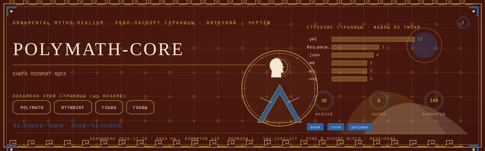

# polymath-core — КНИГА ПОЛИМАТ-ЯДРА

> Общие органы всех агентов дома: один том — общие части, каждая глава — снимок оригинала.

  

<!--ФОРЖ:МУЗА:НАЧАЛО-->

  
   
  

<!--ФОРЖ:МУЗА:КОНЕЦ-->

<!--ФОРЖ:ПАСПОРТ:НАЧАЛО-->

  

| ФАЙЛОВ | ПАПОК | КОММИТОВ | ОБНОВЛЕНО | РЕЛИЗОВ |
|---:|---:|---:|---|---:|
| 34 | 5 | 131 | 2026-11-21 | 1 |
<!--ФОРЖ:ПАСПОРТ:КОНЕЦ-->

## Что это

Ядро дома POLIMAT: то, чем пользуются все агенты, собрано одним томом. Каждая глава —
снимок `main` оригинального репозитория на дату сборки; внутри главы — `PROVENANCE.md`
с источником и SHA снимка. Оригиналы живут отдельными репозиториями, история коммитов
сохранена в них; книга не место правок — правки идут в оригинал.

## Главы

| Глава | Источник | О чём |
|---|---|---|
| [polymath-gen](https://github.com/rtynbirf/polymath-core/tree/main/glavy/polymath-gen) | [rtynbirf/polymath-gen](https://github.com/rtynbirf/polymath-gen) | автономный медиа-агент: задание человека → промпт → изображение/видео → самокритика |

## Как читать

- Открыть главу: `glavy/<глава>/` — файлы лежат как в оригинале.
- Проверить происхождение: `PROVENANCE.md` внутри главы — SHA снимка и дата.
- Работать по главе — в оригинальном репозитории (ссылка в таблице).

## Связи дома

- [polymath-os](https://github.com/rtynbirf/polymath-os) — личная суверенная media-OS, пять слоёв самосборки.
- [cell-swarm](https://github.com/rtynbirf/cell-swarm) — геном и фермент роя клеток.
- [index](https://github.com/rtynbirf/index) — SSOT-реестр аккаунта, живые метрики каждый час.

<!--ФОРЖ:ПОДВАЛ-->
---

  ◆ картина и штандарт — ручная ковка <a href="https://github.com/rtynbirf">КУЗНИ ПОЛИМАТ</a> · ЧЕЛОВЕК=АККАУНТ=PID1 ◆

